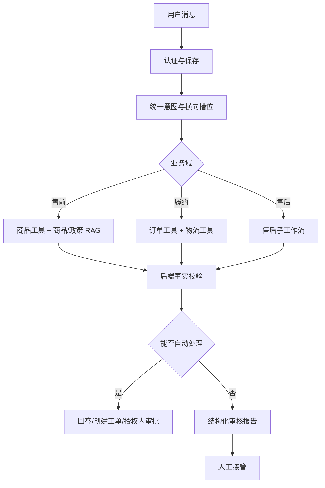
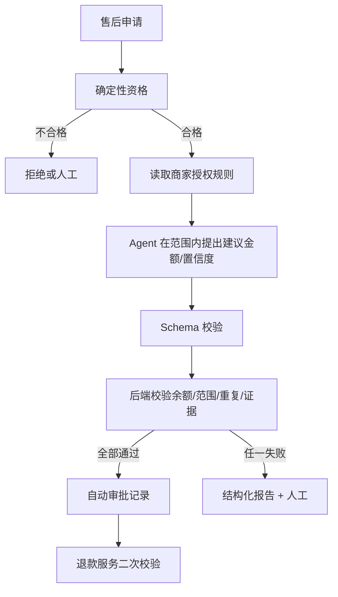

# SmartShop AI 升级架构设计

> 目标：在保留售后安全闭环的前提下，扩展为单商家售前、履约、售后统一智能客服。

## 1. 最终业务架构

```text
消费者端/客服端
       ↓
FastAPI 认证与对象权限
       ↓
统一客服工作流
       ├── 售前：商品/参数/对比/价格/库存/优惠
       ├── 履约：本人订单/多订单/物流/进度
       └── 售后：退/换/修/政策/故障/工单
       ↓
DeepSeek 理解与解释
Tool Calling 结构化查询
BGE + Chroma 知识检索
确定性资格/金额/权限规则
       ↓
自动回答 / 工单 / 人工接管 / 审批
```

## 2. Agent 工作流



## 3. 售前流程

```text
商品名称/用途咨询
→ 商品检索与 RAG
→ 商品参数/价格/库存查询 MySQL
→ 多商品时执行对比
→ 优惠政策检索
→ DeepSeek 组织回答
→ 超出优惠权限转人工
```

## 4. 订单履约流程

```text
本人订单请求
→ 服务端解析订单指代
→ 单候选自动确认，多候选等待选择
→ 查询订单
→ 查询物流
→ RAG 处理物流异常
→ 回答或转人工
```

## 5. 统一售后流程

```text
售后诉求
→ RETURN / EXCHANGE / REPAIR / CONSULT
→ 订单工具
→ 政策 RAG
→ 确定性资格与金额
→ 普通申请创建待审批工单
→ 部分补偿进入授权决策
→ 自动通过或人工审核
→ 后端执行服务
```

## 6. 退款授权决策流程



## 7. 人工审核流程

```text
客服查看待审核任务
→ 用户诉求与证据
→ 订单/商品事实
→ 资格结果
→ RAG 政策来源
→ Agent 建议与置信度
→ 商家授权范围
→ 后端失败原因
→ 人工通过/拒绝
```

## 8. 数据库变更方案

- `products`：规格、价格、库存、上下架；
- `orders`：物流字段；
- `after_sales_tickets`：repair 类型与 Agent 决策摘要；
- `refund_authorization_rules`：授权场景、金额上下限、版本；
- `agent_decisions`：建议金额、依据、置信度、后端校验；
- `refund_executions`：审批后的退款执行状态、幂等键、模拟流水和重试次数；
- `documents`：商品、业务政策、客服 SOP 三分类；
- `discount_authorization_rules`：售前优惠比例和金额上限；
- `discount_quotes`：模拟优惠报价及政策引用；
- `config_audit_logs`：商品、知识、优惠和补偿配置审计。

## 9. API 变更

- `GET /products`、`GET /products/{id}`、`GET /products/compare`；
- 订单响应增加物流字段；
- 售后工单支持 `repair`；
- 补偿审批支持人工最终金额；
- 客服端增加审核报告、失败退款重试和授权配置接口。
- 售前优惠规则 CRUD、模拟报价、知识分类重建和配置审计接口。

## 10. 前端变更

消费者端增加商品咨询、授权优惠报价、物流、售后退款执行状态和统一入口；客服端增加失败退款重试、商品、知识、优惠、补偿授权、审计记录与完整审核报告。现有聊天、订单和工单页面继续复用。

## 11. 新旧架构对照

| 能力 | 当前 | 目标 |
|---|---|---|
| 业务域 | 售后为主 | 售前+履约+售后 |
| 商品数据 | 名称/描述 | 参数/价格/库存 |
| 物流 | 无 | 结构化物流状态 |
| 售后类型 | return/exchange | return/exchange/repair |
| 知识 metadata | product_id | product_id + category |
| 退款决策 | 确定性全额 | 确定性资格 + 授权内 Agent 补偿建议 |
| 前端 | 售后工作台 | 全域客服工作台 |

## 12. 测试策略

- 售前：参数、对比、价格、库存、优惠边界；
- 履约：本人订单、多候选、物流、进度、越权；
- 售后：退换修、期限、资格、重复申请；
- 授权：范围、余额、非法金额、置信度、后端执行；
- 人工：接管、并发、迟到 AI、审批报告；
- RAG：分类过滤、引用、无依据；
- 全链路：消费者端和客服端真实交互。
